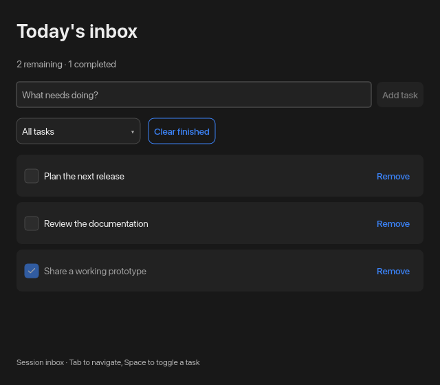

# Lemon

[](https://crates.io/crates/lemon)
[](https://docs.rs/lemon)
[](https://github.com/lucasaarch/lemon/actions/workflows/ci.yml)
[](LICENSE)

A reactive native desktop UI toolkit for Rust.

Build applications with typed state, composable views and GPU rendering. Lemon
handles windowing, input, incremental layout and painting while application code
stays in ordinary Rust.

[Getting started](#getting-started) · [Applications](#applications) · [Guide](docs/guide.md) · [API reference](https://docs.rs/lemon) · [Contributing](CONTRIBUTING.md)

## Features

- Reactive `State`, derived values, effects and isolated component state.
- Fluent layout with rows, columns, positioning and scrolling on both axes.
- Text fields, secure fields, multiline editing, buttons, toggles, selects and sliders.
- Dialogs, popovers, notifications, vector icons and file trees.
- Adaptive light/dark themes, shared fonts, gradients, transitions and GPU effects.
- Multiple native windows, configurable chrome and window lifecycle callbacks.
- A headless UI pipeline for application and input tests.

## Getting started

Requires **Rust 1.88 or newer** and a GPU supported by wgpu. Linux builds need
Fontconfig development headers (`sudo apt-get install libfontconfig1-dev` on Ubuntu).

```sh
cargo add lemon
```

Or add `lemon = "1"` to your dependencies:

```rust,no_run
use lemon::prelude::*;

fn app(cx: &Cx) -> Element {
    let name = cx.state(String::new());
    let greeting = name.clone();

    ColumnView::new()
        .fill()
        .inset(24.0)
        .spacing(16.0)
        .child(Text::new("Your workspace").size(24.0))
        .child(TextField::new(cx, name).placeholder("Your name"))
        .child(Text::new(move || format!("Welcome, {}", greeting.get())))
        .into_element()
}

fn main() {
    run(|cx| {
        cx.open_window(WindowConfig::default().title("Workspace"), app);
    });
}
```

`run` receives an `AppCx` for loading fonts/themes and opening windows. Component
functions receive `Cx` for state and view construction. Hook declarations,
including stateful widget constructors, must run in a stable order; put each
dynamic row in a keyed component scope. See the [application guide](docs/guide.md).

## Applications

Each example is a complete, focused application with working actions and tests.

| Application | What it does | What it teaches |
| --- | --- | --- |
| [tasks](examples/tasks.rs) | A session task inbox with add, complete, filter, remove and clear confirmation | Keyed components, reactive collections, empty states and dialogs |
| [editor](examples/editor.rs) | A UTF-8 file editor with workspace navigation, save, dirty state and disk-conflict detection | File I/O, multiline editing, file trees and window-close veto |
| [preferences](examples/preferences.rs) | Reader preferences with validation, apply/revert and shared preview windows | Forms, custom styling and state shared across windows |
| [focus](examples/focus.rs) | A focus timer with presets, pause/resume, reset and completion notification | Monotonic time, effects, animation-driven frames and component identity |

```sh
git clone https://github.com/lucasaarch/lemon.git
cd lemon
cargo run --example tasks
cargo run --example editor -- ./notes.txt
cargo run --example preferences
cargo run --example focus
```

Tasks and reader preferences are session-local. The editor reads and writes the
path you choose, accepts UTF-8 documents up to 1 MiB and refuses to overwrite an
unopened file or a document changed externally. The focus timer needs its window
to remain open. Details and controls are described in [examples/README.md](examples/README.md).



## Platform support

Lemon targets **Linux, macOS and Windows**. CI builds and runs headless tests on
all three; native runtime checks are currently performed on macOS. Running a
window requires a desktop session and compatible graphics drivers.

Controls are drawn by Lemon rather than supplied by the operating system.
System appearance selects the default palette; it does not provide the widget
rendering. Screen-reader integration and IME composition are not implemented yet.
Web and mobile targets are outside the current desktop API.

The rendering stack uses [winit](https://github.com/rust-windowing/winit),
[wgpu](https://github.com/gfx-rs/wgpu), [Vello](https://github.com/linebender/vello),
[Taffy](https://github.com/DioxusLabs/taffy) and [Parley](https://github.com/linebender/parley).

## Documentation and development

- [Application guide](docs/guide.md): layout, state, themes, styling, events and windows.
- [API reference](https://docs.rs/lemon): source-level documentation and examples.
- [Contributing](CONTRIBUTING.md): setup, tests and the release process.
- [Changelog](CHANGELOG.md): release notes and alpha migration.
- [AGENTS.md](AGENTS.md): repository ownership and implementation constraints.

```sh
make check
cargo doc --no-deps --open
```

The `1.x` public API follows Semantic Versioning. See the changelog for migration
notes; a stable version number does not imply that every desktop capability is
implemented.

## License

Lemon is licensed under [MIT](LICENSE). Bundled Lucide icons retain their
[ISC license](licenses/lucide-LICENSE).
